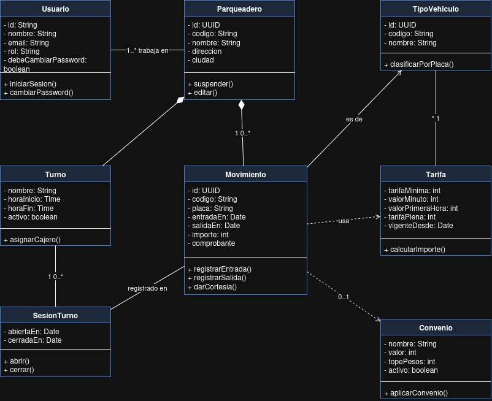

# Diagrama de Clases

> Historia principal: **HU-008 (#31)** · Relacionadas: HU-004 (#27), HU-007 (#30)

## ¿Qué muestra?

El diagrama lleva el análisis ECB al diseño con **8 clases de dominio**. Los atributos son privados (`-`) y las operaciones son públicas (`+`).

| Clase | Responsabilidad |
|---|---|
| `Usuario` | Operario o administrador. Trabaja en uno o más parqueaderos. |
| `Parqueadero` | Establecimiento. Agrupa sus turnos y movimientos. |
| `TipoVehiculo` | Deduce si es carro o moto a partir de la placa (`clasificarPorPlaca()`). |
| `Turno` / `SesionTurno` | Franja horaria declarada y el turno realmente trabajado. |
| `Movimiento` | Estancia de un vehículo: entrada, salida, importe y comprobante. |
| `Tarifa` | Calcula el cobro por tramos (`calcularImporte()`). |
| `Convenio` | Aplica un descuento con tope (`aplicarConvenio()`). |

## Relaciones clave

- **Composición** `Parqueadero ◆── Movimiento` y `Parqueadero ◆── Turno`: no existen fuera de su parqueadero. En eso se basa el aislamiento entre establecimientos.
- **Asociación** `Movimiento → TipoVehiculo` (*es de*): el tipo se resuelve desde la placa (HU-008).
- **Asociación** `Movimiento — SesionTurno` (*registrado en*): cada entrada queda atribuida al turno abierto.
- **Dependencia** `Movimiento ┄> Tarifa` (*usa*) y `Movimiento ┄> Convenio`: el movimiento los usa para calcular, pero **no guarda una referencia a ellos**. Guarda el `importe` y el `comprobante`. Así se cumple HU-004: el cobro no cambia aunque la tarifa cambie después.

## SOLID en una línea

Cada clase tiene una sola responsabilidad (S). Para cambiar precios se declara una nueva versión de `Tarifa` sin tocar código (O/L). `Movimiento` solo conoce las operaciones que necesita (I). El dominio no depende de la base de datos (D).
