# Diagramas de procesos y de secuencia — Parquivo

Este documento explica los diagramas de procesos y de secuencia de los principales flujos de Parquivo. Cada flujo se basa en sus historias de usuario.

- **Diagrama de procesos (actividades):** muestra *qué pasa* en el flujo, quién hace cada paso y qué decisiones se toman.
- **Diagrama de secuencia:** muestra *cómo lo hace el sistema por dentro*, es decir, qué pantalla, acción del servidor, función del dominio y consulta a la base intervienen y en qué orden.

**Cómo leer los diagramas de procesos.** Cada color indica quién hace el paso:

| Color | Significado |
|---|---|
| Azul | Operario o usuario |
| Morado | Administrador |
| Gris | Sistema |
| Rojo | Rechazo o error |
| Amarillo (rombo) | Decisión |

**Cómo leer los diagramas de secuencia.** Los pasos están numerados en orden. Las flechas continuas son llamadas y las punteadas son respuestas. Los recuadros tienen este significado:

- `alt`: caminos alternativos (si pasa una cosa u otra).
- `opt`: un paso opcional.
- `loop`: algo que se repite.

---

## 1. Recibir una bicicleta

> HU-5.1.1, HU-5.1.2, HU-5.1.3, HU-5.5.1

### Procesos

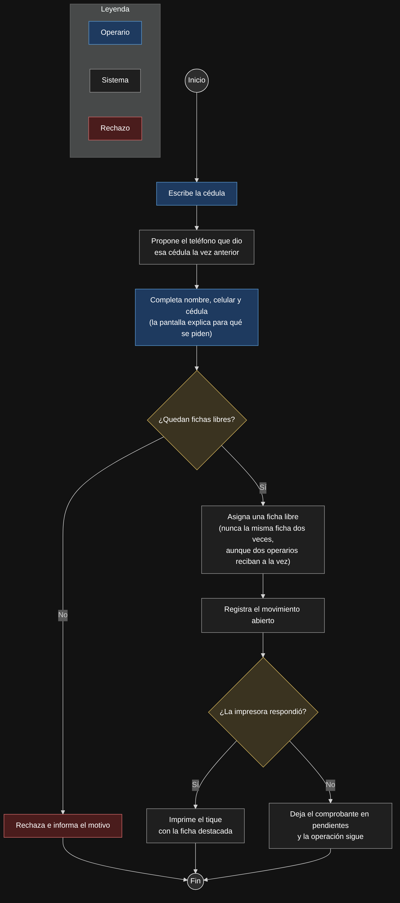

1. El operario escribe la cédula de la persona.
2. El sistema le propone el teléfono que esa cédula dio la vez anterior, para no volver a pedirlo.
3. El operario completa nombre, celular y cédula. La pantalla explica para qué se piden esos datos.
4. **Decisión: ¿quedan fichas libres?**
   - **No:** se rechaza y se informa el motivo.
   - **Sí:** el sistema asigna una ficha libre. Nunca entrega la misma ficha dos veces, aunque dos operarios reciban bicicletas al mismo tiempo.
5. Se registra el movimiento abierto.
6. **Decisión: ¿la impresora respondió?**
   - **Sí:** se imprime el tique con el número de ficha destacado.
   - **No:** el comprobante queda en pendientes y la operación sigue. Una impresora dañada no detiene la taquilla.

### Secuencia

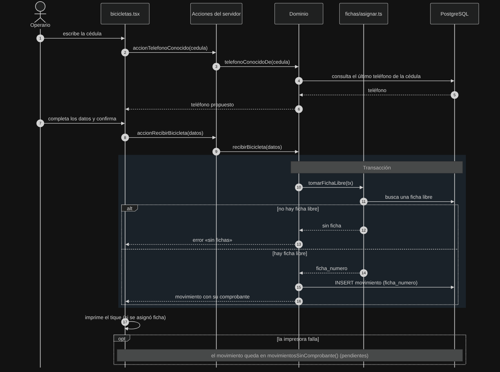

- **Pasos 1–6:** al escribir la cédula, `bicicletas.tsx` llama a `accionTelefonoConocido(cedula)`. Esta pasa al dominio (`telefonoConocidoDe`), que consulta la base y devuelve el teléfono propuesto.
- **Pasos 7–9:** al confirmar, se llama a `accionRecibirBicicleta(datos)` y luego a `recibirBicicleta(datos)` en el dominio.
- **Transacción (pasos 10–16):** `tomarFichaLibre(tx)` busca una ficha libre *dentro de una transacción*. Así se evita que dos operarios tomen la misma ficha.
  - `alt` **no hay ficha:** el dominio devuelve el error «sin fichas».
  - `alt` **hay ficha:** se hace `INSERT` del movimiento con su `ficha_numero` y se devuelve el movimiento con su comprobante.
- **Paso 17 y `opt`:** la pantalla imprime el tique. Si la impresora falla, el movimiento queda en `movimientosSinComprobante()` (pendientes).

---

## 2. Devolver una bicicleta

> HU-5.2.1, HU-5.2.2, HU-5.2.3, HU-5.4.1

### Procesos

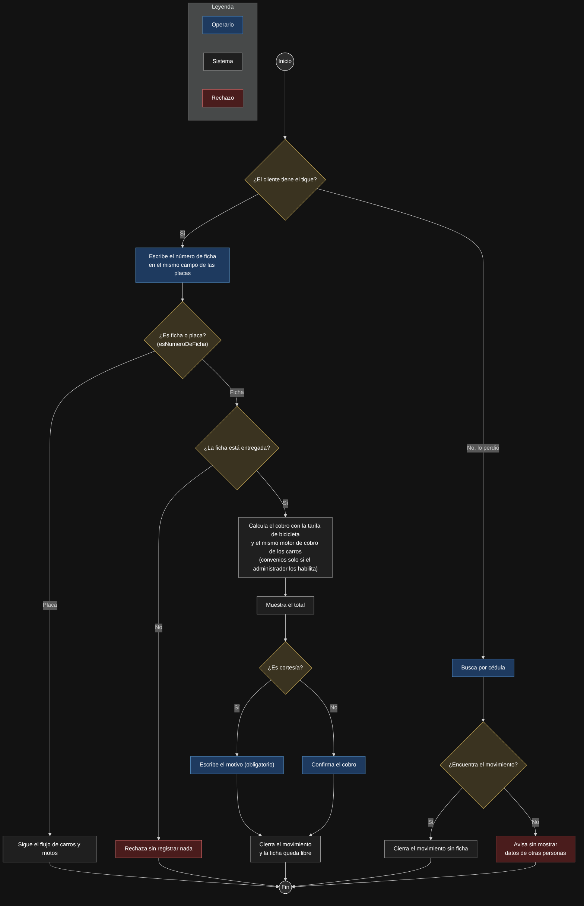

1. **Decisión: ¿el cliente tiene el tique?**
2. **Con tique:** el operario escribe el número de ficha en el *mismo campo* donde escribe las placas.
3. **Decisión: ¿es ficha o placa?** (`esNumeroDeFicha`). Si es placa, sigue el flujo normal de carros y motos.
4. **Decisión: ¿la ficha está entregada?**
   - **No:** se rechaza sin registrar nada.
   - **Sí:** se calcula el cobro con la tarifa de bicicleta y el mismo motor de cobro de los carros. Los convenios no aplican a bicicletas, salvo que el administrador lo habilite.
5. Se muestra el total.
6. **Decisión: ¿es cortesía?**
   - **Sí:** el operario debe escribir un motivo (obligatorio).
   - **No:** el operario confirma el cobro.
7. Se cierra el movimiento y la ficha queda libre para otra bicicleta.
8. **Tique perdido:** el operario busca por cédula.
   - Si encuentra el movimiento, lo cierra sin ficha.
   - Si no, el sistema avisa *sin mostrar datos de otras personas*, para proteger la privacidad.

### Secuencia

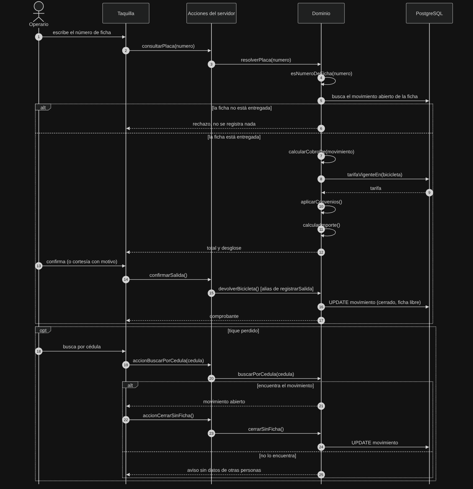

- **Resolver el número:** `consultarPlaca(numero)` → `resolverPlaca()` → `esNumeroDeFicha()`. Después el dominio busca el movimiento abierto de esa ficha.
- `alt` **ficha no entregada:** se rechaza sin registrar nada.
- `alt` **ficha entregada:** se calcula el cobro con `calcularCobroDe()`, que pide `tarifaVigenteEn(bicicleta)`, aplica `aplicarConvenios()` y termina en `calcularImporte()`. La pantalla recibe el total y el desglose.
- **Confirmar:** `confirmarSalida()` → `devolverBicicleta()`, que es un alias de `registrarSalida()`, es decir, el mismo código de los carros. Luego se hace `UPDATE` del movimiento: queda cerrado y la ficha queda libre.
- `opt` **tique perdido:** `accionBuscarPorCedula` → `buscarPorCedula`. Si encuentra el movimiento, se cierra con `accionCerrarSinFicha` → `cerrarSinFicha`. Si no, se avisa sin datos de terceros.

---

## 3. Abrir y cerrar el turno

> HU-4.2.1, HU-4.2.2, HU-2.4.1

### Procesos

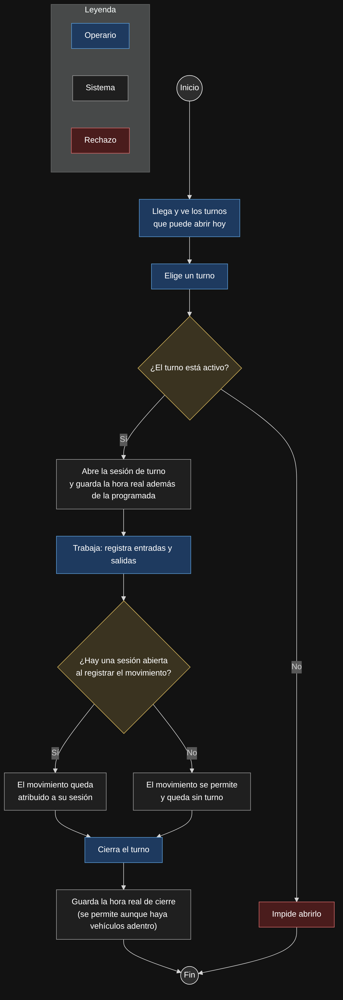

1. El operario llega y ve los turnos que puede abrir hoy. Elige uno.
2. **Decisión: ¿el turno está activo?**
   - **No:** el sistema impide abrirlo.
   - **Sí:** se abre la sesión de turno y se guarda la **hora real** además de la programada. Así se sabe si el operario llegó tarde o temprano.
3. El operario trabaja registrando entradas y salidas.
4. **Decisión: ¿hay una sesión abierta al registrar el movimiento?**
   - **Sí:** el movimiento queda atribuido a esa sesión.
   - **No:** el movimiento se permite igual y queda sin turno. La taquilla nunca se bloquea por esto.
5. El operario cierra el turno y se guarda la hora real de cierre. Se permite cerrar aunque haya vehículos adentro.

### Secuencia

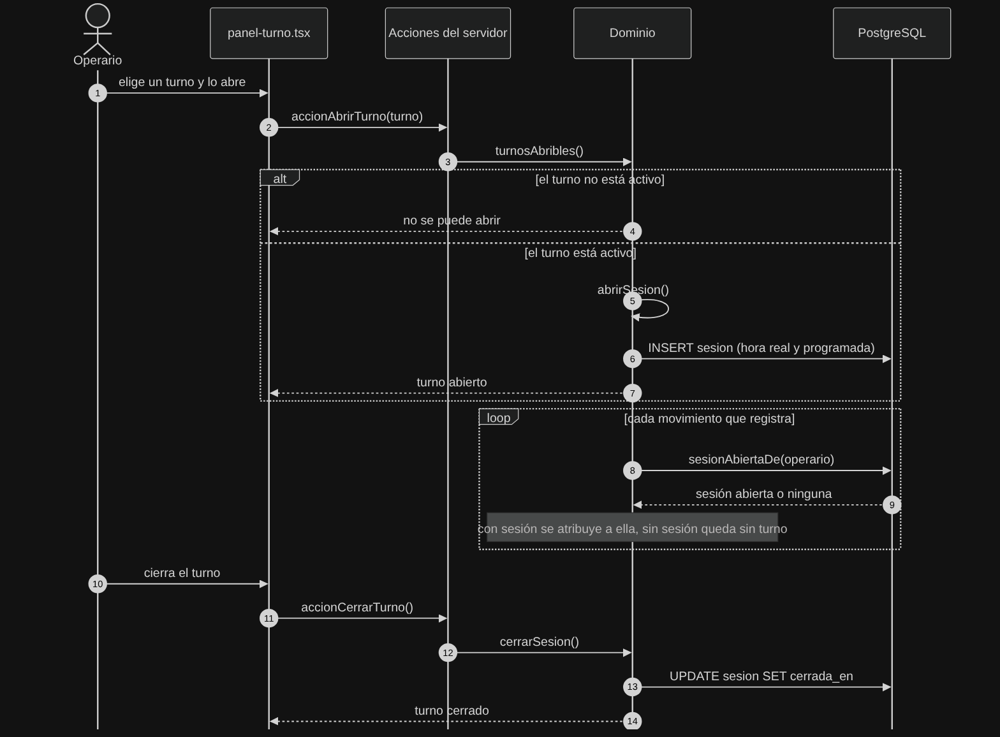

- **Abrir:** `panel-turno.tsx` → `accionAbrirTurno()` → `turnosAbribles()`.
  - `alt` **turno no activo:** no se puede abrir.
  - `alt` **turno activo:** `abrirSesion()` → `INSERT sesion` con la hora real y la programada.
- `loop` **cada movimiento:** al registrar una entrada o salida, el dominio consulta `sesionAbiertaDe(operario)` para saber a qué sesión atribuirla, o dejarlo sin turno.
- **Cerrar:** `accionCerrarTurno()` → `cerrarSesion()` → `UPDATE sesion SET cerrada_en`.

---

## 4. Declarar un convenio y aplicarlo

> HU-3.1.1 a HU-3.1.4, HU-3.2.2

### Procesos

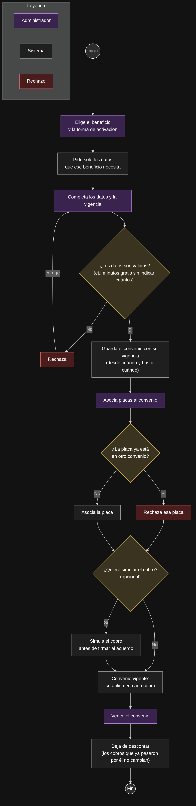

1. El administrador elige el beneficio y la forma de activación.
2. El sistema pide *solo* los datos que ese beneficio necesita.
3. El administrador completa los datos y la vigencia.
4. **Decisión: ¿los datos son válidos?** Por ejemplo, "minutos gratis" sin decir cuántos no es válido.
   - **No:** se rechaza y el administrador corrige.
   - **Sí:** el convenio se guarda con su vigencia (desde cuándo y hasta cuándo).
5. Se asocian placas al convenio. **Decisión: ¿la placa ya está en otro convenio?** Si ya está, se rechaza esa placa. Una placa solo puede tener un convenio.
6. **Opcional:** simular el cobro antes de firmar el acuerdo con la empresa.
7. Mientras está vigente, el convenio se aplica en cada cobro.
8. Cuando vence, deja de descontar, pero **los cobros que ya pasaron por él no cambian**.

### Secuencia (al cobrar)

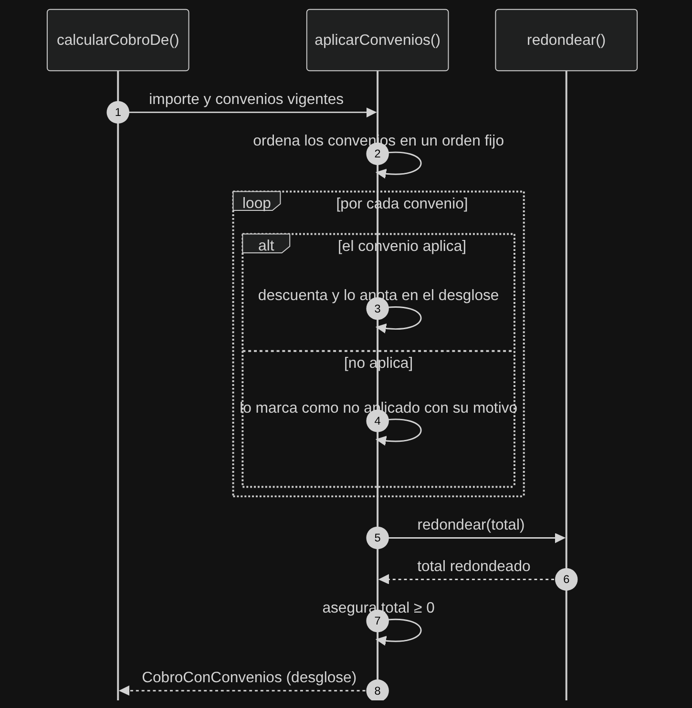

Este diagrama muestra qué hace `aplicarConvenios()` cada vez que se cobra:

1. Recibe de `calcularCobroDe()` el importe y los convenios vigentes.
2. Ordena los convenios en un **orden fijo**, para que el resultado sea siempre el mismo.
3. `loop` **por cada convenio:**
   - `alt` **aplica:** descuenta y lo anota en el desglose.
   - `alt` **no aplica:** lo marca como no aplicado *con su motivo*, para poder explicarle al cliente por qué no se le descontó.
4. Redondea el total con `redondear()`.
5. Se asegura de que el total sea **≥ 0**, es decir, que un descuento nunca deje un cobro negativo.
6. Devuelve el desglose completo (`CobroConConvenios`).

---

## 5. Declarar una tarifa

> HU-2.1.1 a HU-2.1.4

### Procesos

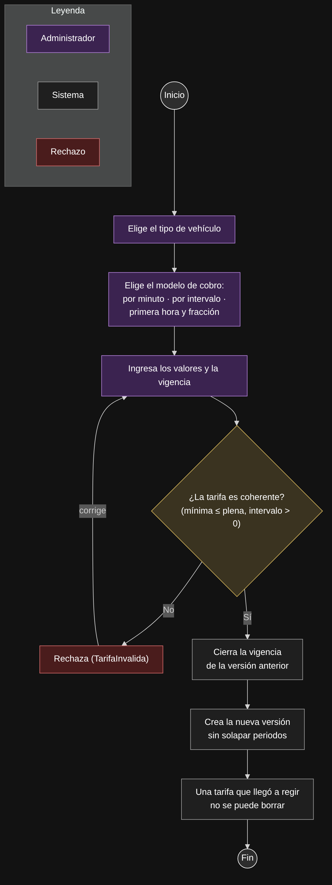

1. El administrador elige el tipo de vehículo.
2. Elige el modelo de cobro: **por minuto**, **por intervalo** o **primera hora y fracción**.
3. Ingresa los valores y la vigencia.
4. **Decisión: ¿la tarifa es coherente?** Por ejemplo, la tarifa mínima no puede ser mayor que la plena y el intervalo debe ser mayor que 0 minutos.
   - **No:** se rechaza (`TarifaInvalida`) y el administrador corrige.
   - **Sí:** se cierra la vigencia de la versión anterior y se crea la nueva *sin solapar periodos*.
5. Una tarifa que llegó a regir **no se puede borrar**. Así cualquier cobro pasado siempre se puede explicar con la tarifa que tenía en ese momento.

### Secuencia

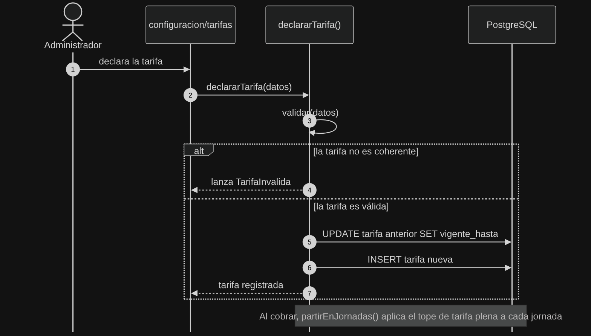

1. Desde `configuracion/tarifas` se llama a `declararTarifa(datos)`.
2. `declararTarifa()` valida los datos.
   - `alt` **no es coherente:** lanza `TarifaInvalida`.
   - `alt` **es válida:** hace `UPDATE` de la tarifa anterior (`vigente_hasta`) e `INSERT` de la tarifa nueva.
3. **Nota:** al cobrar, `partirEnJornadas()` aplica el tope de tarifa plena a *cada jornada por separado*. Así, un vehículo que se queda dos días paga como máximo dos tarifas plenas.

---

## 6. Plataforma: parqueaderos y cuentas

> HU-1.1.x, HU-1.3.x, HU-1.4.x

### Procesos

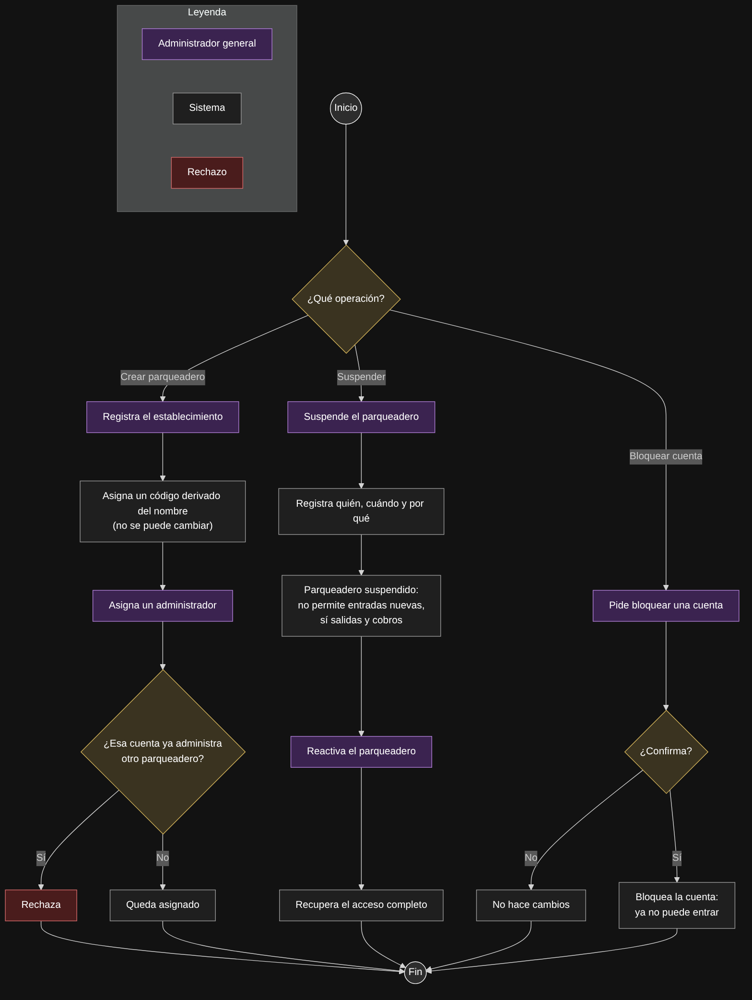

El administrador general puede hacer tres operaciones:

**Crear un parqueadero**
1. Registra el establecimiento.
2. El sistema le asigna un **código derivado del nombre que no se puede cambiar**.
3. Le asigna un administrador. **Decisión: ¿esa cuenta ya administra otro parqueadero?** Si es así, se rechaza: una cuenta administra un solo parqueadero.

**Suspender y reactivar**
1. Al suspender, queda registrado **quién, cuándo y por qué**.
2. En un parqueadero suspendido **no se permiten entradas nuevas**, pero **sí salidas y cobros**, para no dejar vehículos atrapados adentro.
3. Al reactivar, se recupera el acceso completo.

**Bloquear una cuenta**
1. Se pide confirmación. Si no se confirma, no hay cambios.
2. Una cuenta bloqueada ya no puede entrar al sistema.

> Este flujo no tiene diagrama de secuencia.

---

## 7. Iniciar sesión

> HU-1.1.3, HU-1.4.2, HU-1.4.4, HU-1.2.3

### Procesos

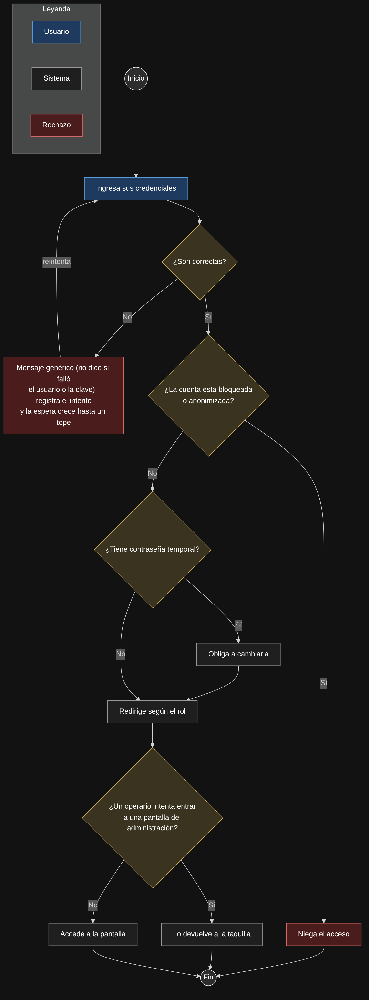

1. El usuario ingresa sus credenciales.
2. **Decisión: ¿son correctas?**
   - **No:** el mensaje es genérico, sin decir si falló el usuario o la clave, para no dar pistas a un atacante. Se registra el intento y la espera antes del siguiente crece progresivamente hasta un tope.
3. **Decisión: ¿la cuenta está bloqueada o anonimizada?** Si es así, se niega el acceso.
4. **Decisión: ¿tiene contraseña temporal?** Si es así, se le obliga a cambiarla antes de seguir.
5. Se redirige según el rol.
6. **Decisión: ¿un operario intenta entrar a una pantalla de administración?** Si es así, se le devuelve a la taquilla.

### Secuencia

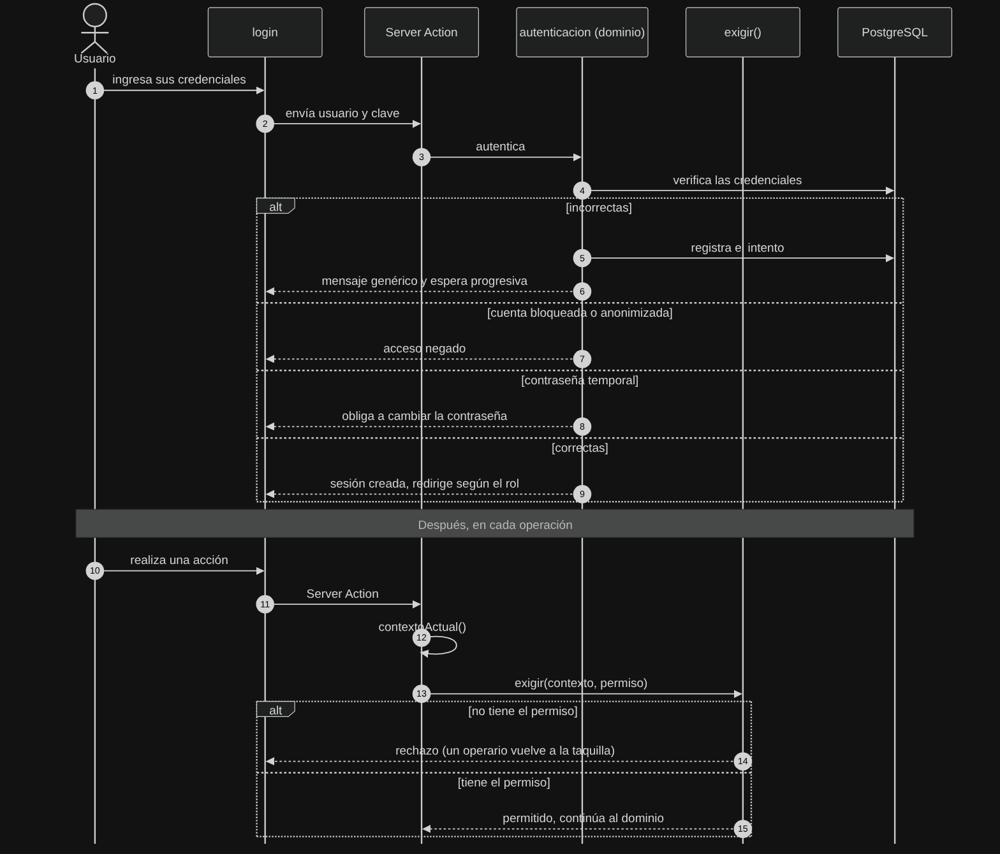

- **Inicio de sesión:** `login` → Server Action → `autenticacion` (dominio) → base de datos. El `alt` muestra las cuatro salidas posibles:
  - credenciales incorrectas: se registra el intento, con mensaje genérico y espera;
  - cuenta bloqueada o anonimizada;
  - contraseña temporal;
  - acceso correcto, con redirección según el rol.
- **En cada operación posterior:** la Server Action obtiene `contextoActual()` y llama a `exigir(contexto, permiso)`.
  - Si no tiene el permiso, se rechaza: un operario vuelve a la taquilla.
  - Si lo tiene, continúa al dominio.

  El permiso se verifica **en el servidor**, no solo ocultando botones en la pantalla.
