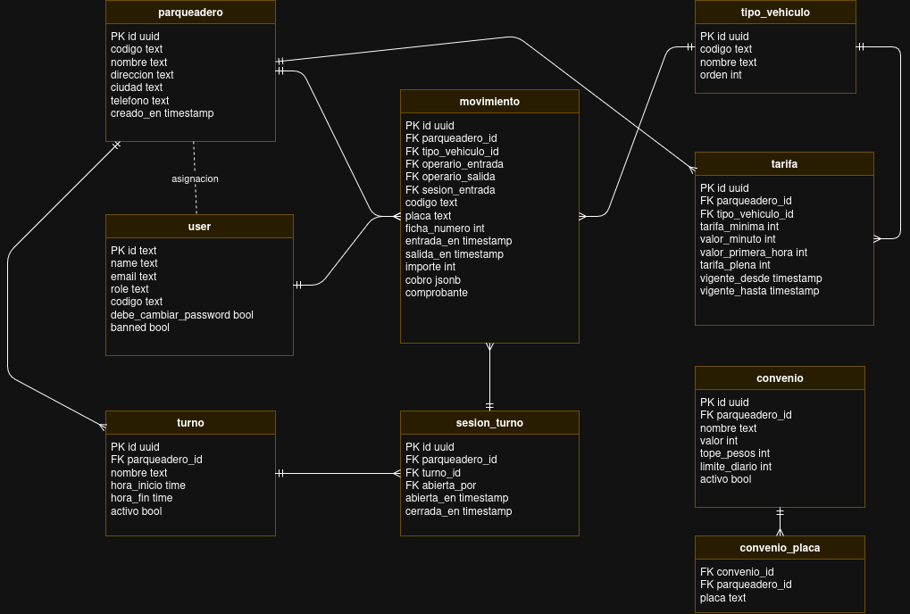

# Modelo de la Base de Datos

> Complementa el [Diagrama de Componentes](diagrama-componentes.md)

## ¿Qué muestra?

Las tablas de PostgreSQL que materializan el diagrama de clases. Son **9 tablas**: una por clase, más `convenio_placa`, que define qué placas pueden usar cada convenio.

## Puntos clave

- **`parqueadero_id` en todas las tablas de negocio.** Es la columna que usa la seguridad por filas (RLS) para que cada parqueadero vea solo sus datos.
- **`movimiento.cobro` (`jsonb`).** Guarda una copia de la tarifa, los tramos y el convenio aplicados en el momento del cobro. Así se cumple **HU-004** y se puede mostrar el desglose de **HU-007** sin recalcular.
- **`tarifa.vigente_desde` / `vigente_hasta`.** Una tarifa nueva cierra la anterior en lugar de sobrescribirla.
- **`movimiento`** registra por separado el operario de entrada, el de salida y la sesión de turno en la que entró el vehículo.
