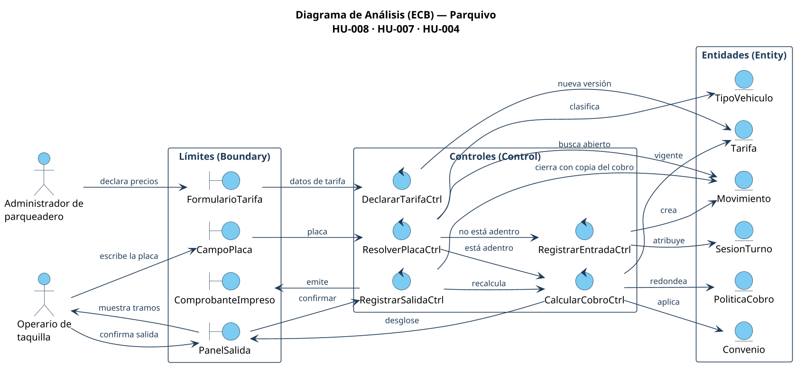

# Diagrama de Análisis (ECB)

Fuente: [`fuentes/analisis-ecb.puml`](fuentes/analisis-ecb.puml)

## Qué modela

El diagrama separa el sistema en las tres clases de análisis de Jacobson para
las historias HU-008, HU-007 y HU-004. Los actores sólo hablan con límites, los
límites sólo hablan con controles y sólo los controles tocan las entidades.

### Actores

| Actor | Rol |
|---|---|
| Operario de taquilla | Atiende la caseta: escribe placas, cobra y entrega el comprobante |
| Administrador de parqueadero | Declara los precios del establecimiento |

### Límites «boundary»

| Límite | Qué hace | Dónde está en el código |
|---|---|---|
| `CampoPlaca` | Único campo de la taquilla: recibe la placa para entrar o para salir | `src/app/(establecimiento)/taquilla/campo-placa.tsx` |
| `PanelSalida` | Muestra el tiempo, los tramos cobrados y los convenios; pide confirmar | `src/app/(establecimiento)/taquilla/campo-placa.tsx` |
| `ComprobanteImpreso` | El tiquete de entrada o de salida que sale por la impresora térmica | `src/app/(establecimiento)/taquilla/comprobante-html.ts` |
| `FormularioTarifa` | Formulario donde el administrador declara la tarifa por tipo de vehículo | `src/app/(establecimiento)/configuracion/tarifas/formulario.tsx` |

### Controles «control»

| Control | Responsabilidad | Código |
|---|---|---|
| `ResolverPlacaCtrl` | Normaliza y clasifica la placa; decide si es entrada o salida con una sola consulta (HU-008) | `src/dominio/taquilla/resolver.ts` |
| `RegistrarEntradaCtrl` | Crea el movimiento abierto y lo atribuye al turno del operario | `src/dominio/taquilla/registrar.ts` |
| `CalcularCobroCtrl` | Toma la tarifa vigente, aplica convenios y redondeo y arma el desglose (HU-007) | `src/dominio/taquilla/resolver.ts` → `calcularCobroDe` |
| `RegistrarSalidaCtrl` | Recalcula en el instante de salida y cierra el movimiento con una copia del cobro (HU-004) | `src/dominio/taquilla/registrar.ts` |
| `DeclararTarifaCtrl` | Valida la tarifa y crea una versión nueva sin borrar la anterior | `src/dominio/tarifas/declarar.ts` |

### Entidades «entity»

| Entidad | Qué persiste |
|---|---|
| `Movimiento` | Una estadía: placa, entrada, salida, importe y la copia (snapshot) del cobro |
| `TipoVehiculo` | Carro o moto; se deduce de la placa, nunca lo elige el operario |
| `Tarifa` | Precios por tipo de vehículo, versionados por vigencia |
| `Convenio` | Beneficios que modifican el importe (minutos gratis, porcentaje, tarifa fija) |
| `PoliticaCobro` | La regla de redondeo del establecimiento |
| `SesionTurno` | El turno abierto del operario, al que se atribuye cada movimiento |

## Cómo se recorre

1. **HU-008.** El operario escribe la placa en `CampoPlaca`. `ResolverPlacaCtrl`
   busca un `Movimiento` abierto con esa placa: si no existe, deriva a
   `RegistrarEntradaCtrl`, que crea el movimiento; si existe, deriva a
   `CalcularCobroCtrl`.
2. **HU-007.** `CalcularCobroCtrl` consulta la `Tarifa` vigente, los `Convenio`
   aplicables y la `PoliticaCobro`, y entrega el desglose a `PanelSalida`.
3. **HU-004.** Al confirmar, `RegistrarSalidaCtrl` recalcula y cierra el
   `Movimiento` guardando **una copia** del cobro. Si el administrador declara
   después una tarifa nueva, `DeclararTarifaCtrl` crea otra versión y el
   movimiento cerrado no cambia.
