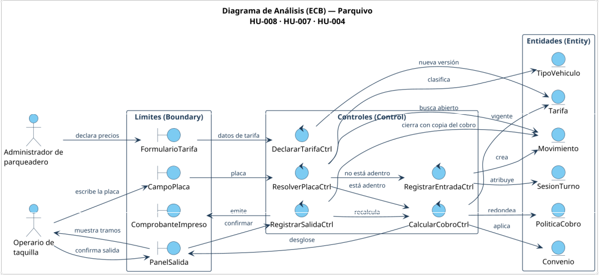

# Diagrama de Análisis (ECB)

> Historia principal: **HU-008 (#31)** · Relacionadas: HU-004 (#27), HU-007 (#30)

## ¿Qué muestra?

El diagrama divide el sistema en tres tipos de clases de análisis:

- **Boundary (límite):** lo que tocan los actores.
- **Control:** contiene la lógica y coordina el trabajo.
- **Entity (entidad):** los datos que se guardan.

Los actores solo hablan con límites, y solo los controles tocan las entidades.

| Tipo | Elementos |
|---|---|
| Actores | Operario de taquilla, Administrador de parqueadero |
| «boundary» | CampoPlaca, PanelSalida, ComprobanteImpreso, FormularioTarifa |
| «control» | ResolverPlacaCtrl, RegistrarEntradaCtrl, CalcularCobroCtrl, RegistrarSalidaCtrl, DeclararTarifaCtrl |
| «entity» | Movimiento, TipoVehiculo, Tarifa, Convenio, PoliticaCobro, SesionTurno |

## Recorrido

1. **HU-008.** El operario escribe la placa en `CampoPlaca`. `ResolverPlacaCtrl` clasifica el vehículo y busca un `Movimiento` abierto con esa placa.
   - Si no hay ninguno, `RegistrarEntradaCtrl` registra la entrada.
   - Si ya hay uno, pasa a `CalcularCobroCtrl`.
2. **HU-007.** `CalcularCobroCtrl` toma la `Tarifa` vigente, aplica el `Convenio` y el redondeo de `PoliticaCobro`, y muestra el desglose en `PanelSalida`.
3. **HU-004.** `RegistrarSalidaCtrl` cierra el movimiento, guarda una copia del cobro e imprime el comprobante. Si después cambia la tarifa, los cobros ya hechos no cambian.
