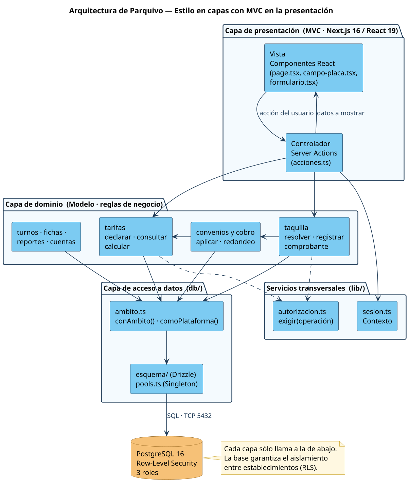
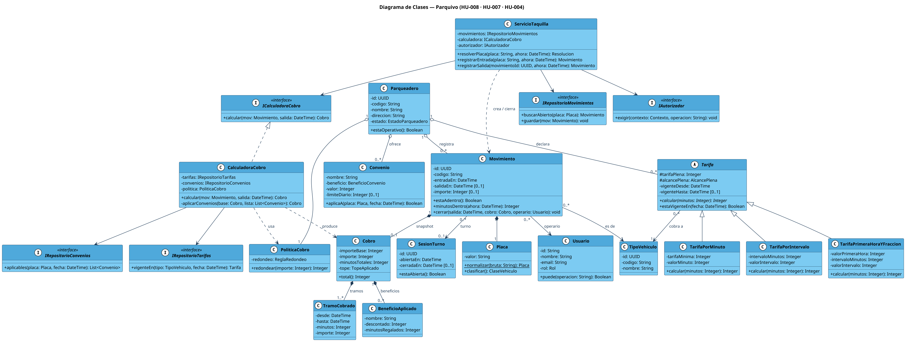
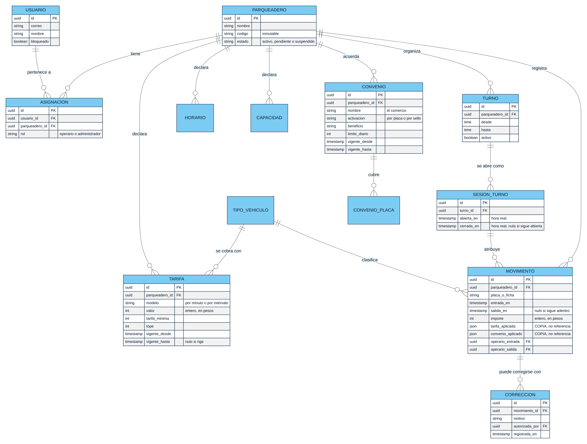
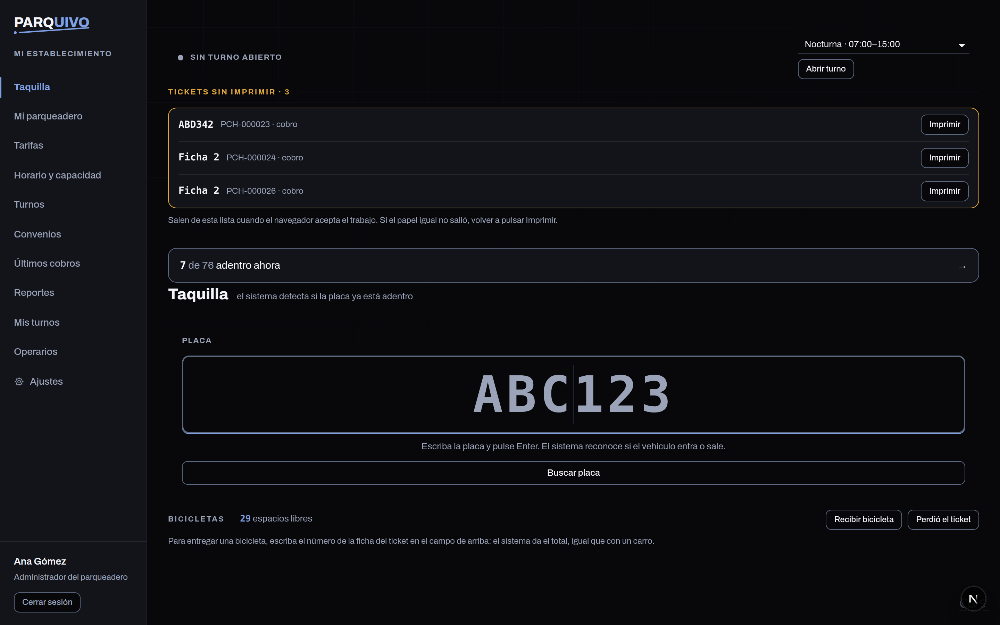
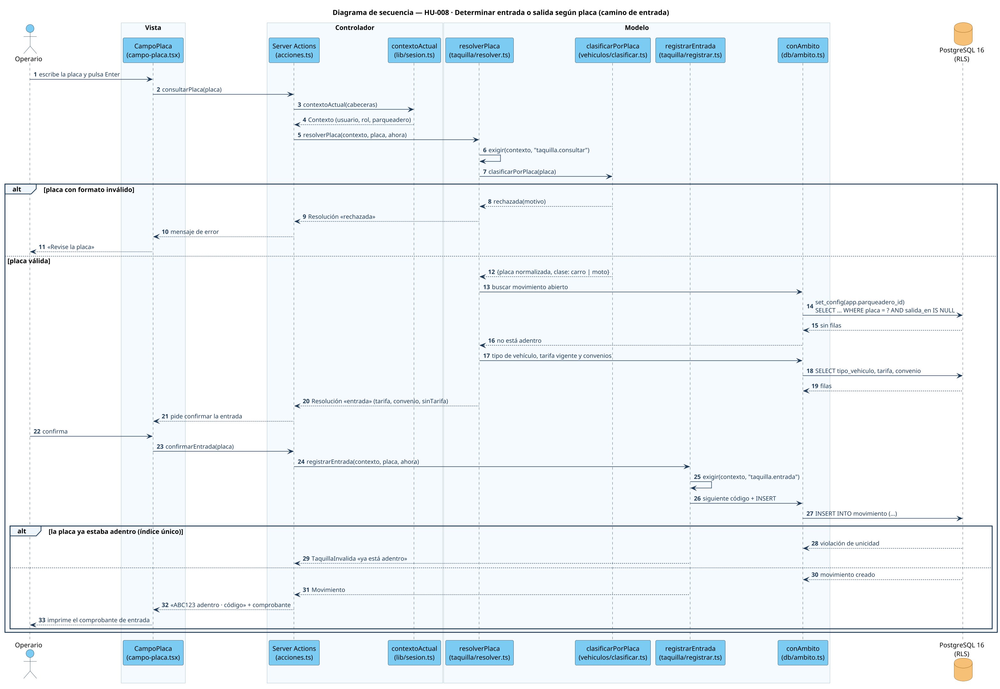
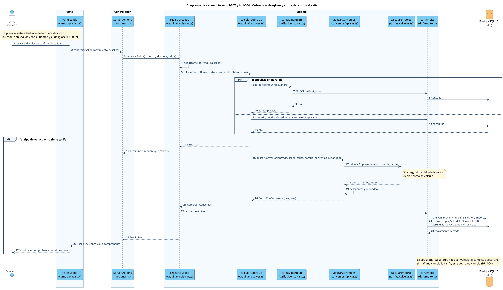
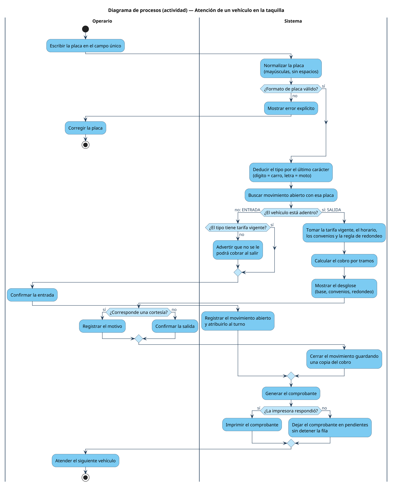
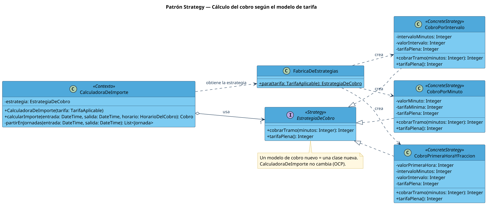
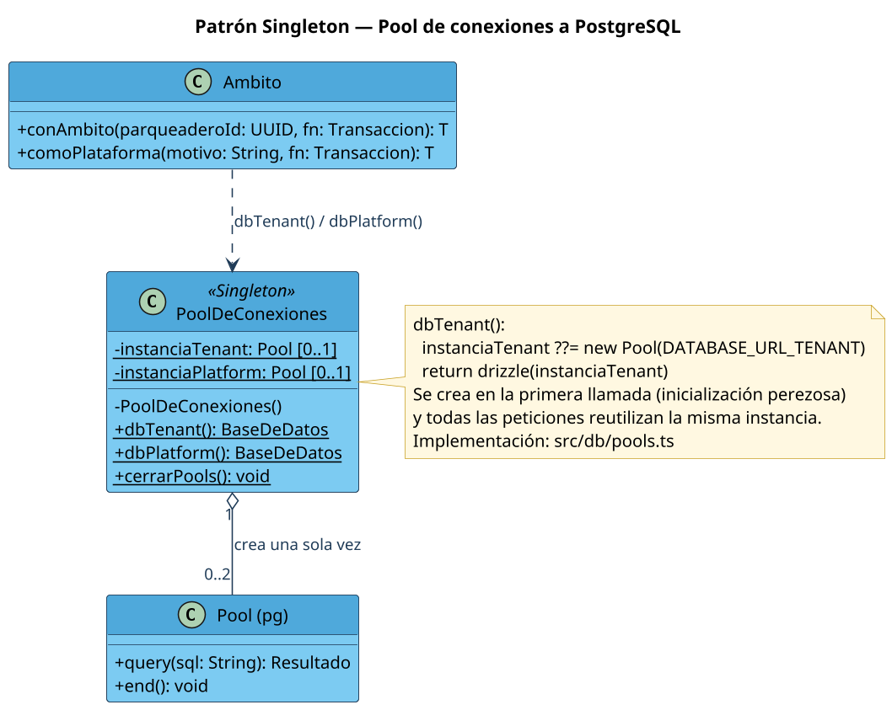
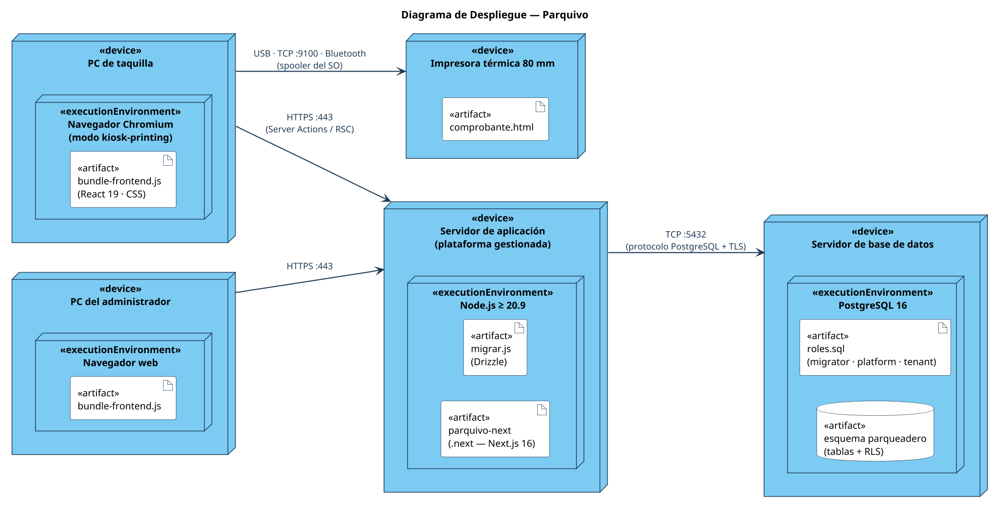

# Documento de Diseño de Software (SDD)

**Parquivo** · Fundamentos de Ingeniería de Software (12946) · 2026-2
**Entrega 2** · 23 de octubre de 2026

| | |
|---|---|
| **Equipo** | Cristian Quevedo · Sergio Alexander Lara Bonilla · Jacob Riveros · Santiago Arias |
| **Docente** | Ing. Kerwin de Jesús Barros Somerson |
| **Requisitos de referencia** | [SRS](../SRS/SRS-simplificado.md) · [Historias de usuario](../Entrega-1/historias-de-usuario.md) |
| **Versión** | 1.0 |

---

## Contenido

1. [Introducción](#1-introducción)
2. [Arquitectura del sistema](#2-arquitectura-del-sistema)
3. [Diseño de datos y clases](#3-diseño-de-datos-y-clases)
4. [Diseño de componentes](#4-diseño-de-componentes)
5. [Diseño de interfaces](#5-diseño-de-interfaces)
6. [Diseño dinámico: secuencia y procesos](#6-diseño-dinámico-secuencia-y-procesos)
7. [Patrones de diseño](#7-patrones-de-diseño)
8. [Principios de diseño aplicados](#8-principios-de-diseño-aplicados)
9. [Diseño de despliegue](#9-diseño-de-despliegue)
10. [Trazabilidad](#10-trazabilidad)

---

## 1. Introducción

### 1.1 Propósito

Este documento describe cómo está construido Parquivo: su arquitectura, sus
datos, sus componentes, cómo interactúan en el tiempo y dónde se despliegan.
Complementa al SRS, que dice **qué** debe hacer el sistema; el SDD dice
**cómo** lo hace.

### 1.2 Alcance

El diseño se centra en las tres historias de usuario más críticas, que forman
el ciclo completo de un vehículo y son la ruta crítica del producto:

| Issue | Historia | HU del documento | Prioridad | Puntos |
|---|---|---|---|---|
| [#31](https://github.com/Alexander-hub-co/Fundamentos_Ing_SW/issues/31) | **HU-008 · Determinar entrada o salida según placa** — la más difícil | HU-4.1.1, HU-4.1.3 | Alta | 8 |
| [#27](https://github.com/Alexander-hub-co/Fundamentos_Ing_SW/issues/27) | HU-004 · Snapshot de tarifa y convenio al momento del cobro | HU-2.1.3, HU-3.1.3 (en parte) | Alta | 8 |
| [#30](https://github.com/Alexander-hub-co/Fundamentos_Ing_SW/issues/30) | HU-007 · Detalle del cálculo del cobro | HU-4.1.4 | Alta | 5 |

**HU-008 es la historia más difícil del backlog**: concentra la clasificación
del vehículo por la placa, la decisión entre entrada y salida con una sola
consulta, la concurrencia (dos registros simultáneos de la misma placa deben
dejar un único movimiento abierto) y el disparo del cálculo del cobro. Es la
historia que implementa el primer prototipo.

### 1.3 Tecnologías

| Capa | Tecnología |
|---|---|
| Presentación | Next.js 16 · React 19 |
| Lógica de negocio | TypeScript sobre Node.js ≥ 20.9 |
| Acceso a datos | Drizzle ORM · `pg` |
| Base de datos | PostgreSQL 16 con Row-Level Security |
| Autenticación | Better Auth |
| Pruebas | Vitest |

---

## 2. Arquitectura del sistema

### 2.1 Estilo arquitectónico

Parquivo combina dos estilos:

- **Capas.** Presentación, dominio y acceso a datos, más servicios
  transversales de sesión y autorización. Cada capa sólo llama a la de abajo.
- **Modelo-Vista-Controlador** dentro de la capa de presentación. La **vista**
  son los componentes React; el **controlador**, las *Server Actions* de
  Next.js (`acciones.ts`), que reciben la petición, piden al modelo y deciden
  qué mostrar; el **modelo**, los módulos de `src/dominio/` con las reglas de
  negocio y `src/db/` con la persistencia.

**Por qué este estilo.** El cobro tiene reglas que cambian por establecimiento
(tarifas, convenios, redondeo) y no pueden quedar enredadas con la pantalla.
Separar el dominio permite probarlo sin interfaz: las pruebas de `tests/`
ejercitan el cálculo del cobro directamente. Además, ninguna regla de negocio
vive en la vista, que es el error del *Fat View* que se quiere evitar.

### 2.2 Vistas de la arquitectura (4+1)

| Vista | Qué muestra | Dónde está en este documento |
|---|---|---|
| **Escenarios (+1)** | Los casos de uso y las historias que guían el diseño | §1.2 y [casos de uso](../Entrega-1/casos-de-uso.md) |
| **Lógica** | Clases del dominio y sus relaciones | §3 · diagrama de clases |
| **Procesos** | Cómo colaboran los objetos en el tiempo | §6 · secuencia y actividad |
| **Desarrollo (implementación)** | Cómo se organiza el software en módulos | §4 · diagrama de componentes |
| **Física (despliegue)** | En qué nodos corre cada pieza | §9 · diagrama de despliegue |

### 2.3 Decisiones de arquitectura

| Decisión | Motivo |
|---|---|
| El aislamiento entre establecimientos lo garantiza PostgreSQL con RLS | Un error en el código de aplicación no puede filtrar datos de otro parqueadero |
| Tres roles de base de datos (migrador, plataforma, inquilino) | La aplicación en marcha nunca usa el rol dueño del esquema |
| El cobro se guarda como copia (JSON) dentro del movimiento | Un cambio de tarifa no altera lo ya cobrado (HU-004) |
| La impresión sale del navegador de la caseta | El servidor no alcanza una impresora con dirección privada del local |

---

## 3. Diseño de datos y clases

### 3.1 Diagrama de clases

Tres grupos: **servicios** con la lógica de negocio (`ServicioTaquilla`,
`CalculadoraCobro`), **interfaces** de las que dependen (`ICalculadoraCobro`,
repositorios, `IAutorizador`) y el **dominio** (`Movimiento`, `Tarifa`,
`Convenio`, `Cobro`…). La explicación completa de relaciones y SOLID está en
[`docs/diagramas/diagrama-clases.md`](../Diagramas/clases.md).

### 3.2 Modelo de la base de datos

Cada tabla de un establecimiento lleva `parqueadero_id` y una política RLS que
la filtra por el establecimiento de la sesión. Las restricciones que protegen el
dinero viven en la base y no sólo en el código:

| Restricción | Qué garantiza |
|---|---|
| `movimiento_una_placa_adentro` (índice único parcial) | Una placa no puede tener dos entradas abiertas, aunque lleguen dos peticiones a la vez (HU-008) |
| `movimiento_cerrado_completo` | Un movimiento cerrado siempre tiene importe y copia del cobro (HU-004) |
| `tarifa_una_vigente_por_tipo` | Sólo hay una tarifa vigente por tipo de vehículo |
| `tarifa_parametros_del_modelo` | Cada modelo de tarifa tiene exactamente sus parámetros |
| `movimiento_importe_no_negativo` | Nunca se cobra un valor negativo |

Detalle de tablas y columnas: [`Database/modelo-entidad-relacion.md`](../../Database/modelo-entidad-relacion.md).

---

## 4. Diseño de componentes

| Interfaz | La provee | La requiere |
|---|---|---|
| `ITaquilla` | Taquilla | Interfaz de Taquilla |
| `IConfigTarifas` | Tarifas | Interfaz de Configuración |
| `ICalculoCobro` | Cobro y Convenios | Taquilla |
| `ITarifaVigente` | Tarifas | Cobro y Convenios |
| `IContexto` | Autenticación y Autorización | Taquilla, Tarifas |
| `IAmbito` | Persistencia | Taquilla, Cobro y Convenios, Autenticación |

Ningún componente toca la base directamente: todo pasa por `IAmbito`, que fija
el establecimiento antes de cualquier consulta. Explicación completa en
[`docs/diagramas/diagrama-componentes.md`](../Diagramas/componentes.md).

---

## 5. Diseño de interfaces

### 5.1 Interfaz de usuario

Las 23 pantallas del sistema están en [`Docs/Mockups/`](../Mockups/). La
pantalla central es la taquilla:

El diseño sigue los principios de usabilidad de Nielsen vistos en clase:

| Principio | Cómo se aplica en la taquilla |
|---|---|
| Visibilidad del estado del sistema | Tras cada operación se confirma qué pasó: «ABC123 adentro», «salió · se cobró $X» |
| Prevención de errores | Una placa con formato inválido se rechaza antes de registrar nada; se avisa si el vehículo no tiene tarifa |
| Reconocer antes que recordar | Un único campo: el operario no elige entre «entrada» y «salida», el sistema lo deduce |
| Flexibilidad y eficiencia | Todo se opera con el teclado: placa + Enter |
| Ayudar a reconocer y corregir errores | Los mensajes dicen qué falló y qué hacer: «Revise la placa» |
| Diseño minimalista | La pantalla muestra lo necesario para atender la fila y nada más |

### 5.2 Interfaces externas

| Interfaz | Con quién | Protocolo |
|---|---|---|
| Base de datos | PostgreSQL 16 | Protocolo PostgreSQL sobre TCP 5432 con TLS |
| Autenticación | Better Auth (librería) | Llamadas en proceso |
| Impresión | Impresora térmica de 80 mm | Spooler del sistema operativo: USB, red (9100) o Bluetooth |
| Usuarios | Navegador web | HTTPS 443 |

---

## 6. Diseño dinámico: secuencia y procesos

### 6.1 Secuencia — HU-008: entrada por placa

La vista nunca habla con el modelo: todo pasa por la *Server Action*. La
decisión entre entrada y salida es **una sola consulta** en el servidor. Si dos
operarios registran la misma placa a la vez, el índice único de la base rechaza
la segunda inserción y el sistema responde «ya está adentro».

### 6.2 Secuencia — HU-007 y HU-004: cobro y copia del cobro

Las consultas de tarifa, horario, redondeo y convenios se hacen **en
paralelo**. El cálculo produce un `CobroConConvenios` con el desglose completo
(HU-007), y al cerrar el movimiento ese objeto se guarda como copia en la
columna `cobro` (HU-004). La condición `salida_en IS NULL` en el `UPDATE`
impide cobrar dos veces el mismo movimiento.

### 6.3 Diagrama de procesos — atención de un vehículo

El proceso muestra el flujo completo con sus decisiones: placa inválida, entrada
o salida, vehículo sin tarifa, cortesía y falla de la impresora. Una impresora
que no responde **no detiene la fila**: el comprobante queda en pendientes.

---

## 7. Patrones de diseño

Se aplican dos patrones de diseño del catálogo GoF, más los patrones
arquitectónicos y GRASP que estructuran el sistema.

### 7.1 Strategy — cálculo del cobro según el modelo de tarifa

| | |
|---|---|
| **Problema** | Cada establecimiento elige cómo cobra: por minuto, por intervalos o primera hora y fracción, y pueden aparecer modelos nuevos |
| **Solución** | Cada modelo es una estrategia concreta que implementa `EstrategiaDeCobro`. `CalculadoraDeImporte` (contexto) parte el tiempo en jornadas y le pide a la estrategia el valor de cada tramo, sin saber qué modelo es |
| **Participantes** | Contexto: `CalculadoraDeImporte` · Estrategia: `EstrategiaDeCobro` · Estrategias concretas: `CobroPorMinuto`, `CobroPorIntervalo`, `CobroPrimeraHoraYFraccion` · Creación: `FabricaDeEstrategias` |
| **Beneficio** | Un modelo de cobro nuevo es una clase nueva; el cálculo de jornadas, topes y convenios no se toca (principio abierto/cerrado) |
| **En el código** | Los tres modelos son la unión `TarifaAplicable` en [`src/dominio/tarifas/modelos.ts`](../../src/dominio/tarifas/modelos.ts) y el cálculo en [`src/dominio/tarifas/calcular.ts`](../../src/dominio/tarifas/calcular.ts) |

### 7.2 Singleton — pool de conexiones a la base de datos

| | |
|---|---|
| **Problema** | Abrir un pool de conexiones a PostgreSQL por cada petición agota las conexiones del servidor |
| **Solución** | Existe una única instancia del pool por rol de base de datos. Se crea en la primera llamada (inicialización perezosa con `??=`) y todas las peticiones la reutilizan |
| **Participantes** | `PoolDeConexiones` con sus instancias `instanciaTenant` e `instanciaPlatform`, y los accesos `dbTenant()` y `dbPlatform()` |
| **En el código** | [`src/db/pools.ts`](../../src/db/pools.ts) |

### 7.3 Patrones arquitectónicos y GRASP

| Patrón | Dónde se aplica |
|---|---|
| **MVC** | Vista: componentes React · Controlador: *Server Actions* (`acciones.ts`) · Modelo: `src/dominio/` y `src/db/` |
| **Capas** | Presentación → dominio → acceso a datos → PostgreSQL (§2.1) |
| **GRASP Controlador** | Las *Server Actions* reciben los eventos del sistema (consultar placa, confirmar entrada, confirmar salida) y los delegan al dominio |
| **GRASP Experto en información** | `Movimiento` sabe si está adentro y cuántos minutos lleva; `Tarifa` sabe si está vigente en una fecha |
| **GRASP Bajo acoplamiento** | La taquilla depende de `ICalculoCobro` y no de cómo se calcula |

---

## 8. Principios de diseño aplicados

| Principio | Cómo se aplica |
|---|---|
| **Responsabilidad única (SRP)** | `clasificar.ts` sólo clasifica la placa; `redondeo.ts` sólo redondea; `resolver.ts` sólo decide entrada o salida |
| **Abierto/cerrado (OCP)** | Un modelo de tarifa o un tipo de beneficio de convenio nuevo se agrega sin modificar el flujo de la taquilla |
| **Sustitución de Liskov (LSP)** | Todo modelo de tarifa cumple el mismo contrato: importe entero, no negativo y nunca mayor que la tarifa plena |
| **Segregación de interfaces (ISP)** | Interfaces pequeñas por necesidad: `ITarifaVigente`, `ICalculoCobro`, `IContexto` |
| **Inversión de dependencias (DIP)** | La taquilla depende de abstracciones del cálculo y del acceso a datos, no de PostgreSQL |
| **Encapsular la variabilidad** | La regla «último carácter dígito = carro, letra = moto» vive aislada en `clasificar.ts`; si cambia la convención, no se toca la taquilla |
| **Una y sólo una vez (DRY)** | La normalización de la placa existe en un único lugar (`vehiculos/placa.ts`) y la usan tanto la taquilla como los convenios por placa |
| **Ley de Demeter** | La taquilla pide `calcularCobroDe(movimiento)` en lugar de recorrer la tarifa, el horario y los convenios por su cuenta |
| **Alta cohesión, bajo acoplamiento** | Cada carpeta de `src/dominio/` corresponde a un concepto del negocio y se comunica con las demás por funciones públicas |

---

## 9. Diseño de despliegue

| Nodo | Requisitos mínimos |
|---|---|
| PC de taquilla | Equipo capaz de ejecutar Chromium; impresora térmica de 80 mm como predeterminada |
| Servidor de aplicación | Node.js 20.9 o superior; certificado TLS para el dominio |
| Servidor de base de datos | PostgreSQL 16 o superior con permiso para crear roles con `BYPASSRLS` |

El procedimiento de instalación en producción está en el
[manual de despliegue](../UserGuide/despliegue.md).

---

## 10. Trazabilidad

| Historia | Clases | Secuencia | Código |
|---|---|---|---|
| HU-008 | `ServicioTaquilla`, `Placa`, `Movimiento` | §6.1 | `dominio/taquilla/resolver.ts`, `registrar.ts` |
| HU-007 | `CalculadoraCobro`, `Cobro`, `TramoCobrado`, `BeneficioAplicado` | §6.2 | `dominio/convenios/aplicar.ts`, `tarifas/calcular.ts` |
| HU-004 | `Movimiento` ◆ `Cobro` (composición) | §6.2 | `dominio/taquilla/registrar.ts` |
