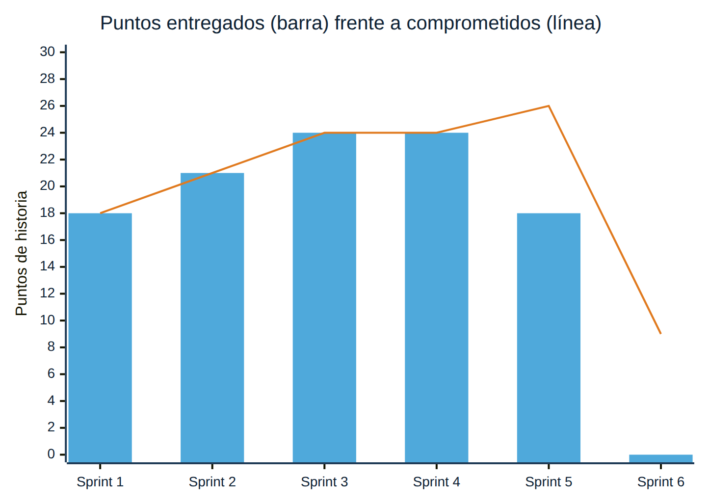
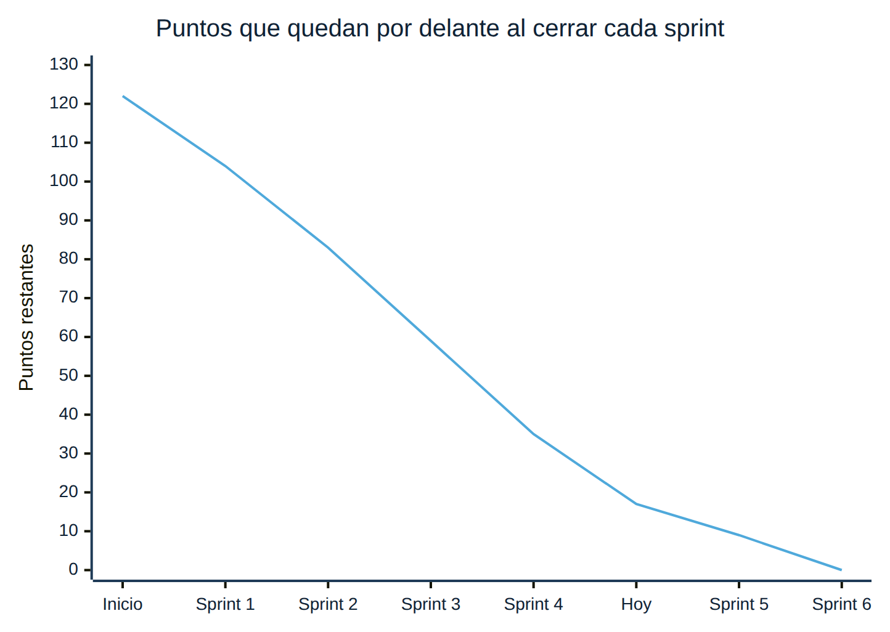
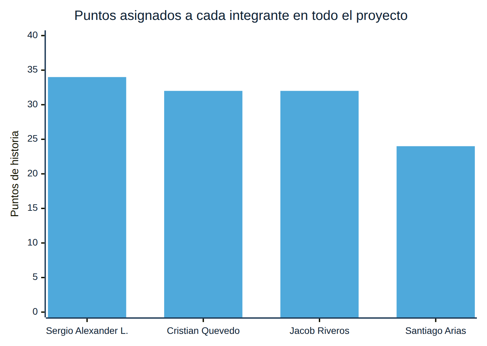

# Reporte gerencial — Entrega 2

**Parquivo** · Fundamentos de Ingeniería de Software (12946) · 2026-2
**Corte:** 23 de octubre de 2026 · Sprint 5 en curso
**Periodo que cubre:** Sprints 3, 4 y 5 (15 de septiembre al 23 de octubre de 2026)

---

## 1. Resumen ejecutivo

Desde la Entrega 1 se cerraron dos sprints completos y el tercero va por la
mitad. **Los cuatro sprints cerrados entregaron el 100 % de lo comprometido:
87 de 87 puntos.** La velocidad se estabilizó en 24 puntos por sprint desde que
el equipo estima entre los cuatro.

El ciclo completo de un vehículo —entrada, cálculo del cobro con desglose,
salida y copia del cobro— está construido, probado e integrado. **El primer
prototipo implementa la historia más difícil, HU-008 · Determinar entrada o
salida según placa**, y además todo el flujo de cobro que depende de ella.

El problema principal del periodo no fue de construcción sino de registro: **el
tablero no reflejó el avance real**. Las historias de los sprints 3 y 4 se
terminaron dentro de su sprint pero se cerraron en el tablero el 16 de octubre.
La sección 6 explica la causa y lo que se cambió.

---

## 2. Indicadores

| Indicador | Entrega 1 (22 sep) | Entrega 2 (23 oct) |
|---|:---:|:---:|
| Sprints cerrados | 2 | 4 |
| Puntos entregados | 39 | **100** |
| Puntos que quedan | 83 | **22** |
| Velocidad media | 19,5 | **21,75** |
| Cumplimiento de lo comprometido | 100 % | **100 %** |
| *Issues* cerrados en el tablero | 18 | **42** |
| *Pull requests* fusionados | 18 | **25** |
| Avance total del proyecto (puntos) | 32 % | **82 %** |

---

## 3. Valores estimados frente a reales

### 3.1 Puntos por sprint

| Sprint | Periodo | Comprometido | Entregado | Desviación |
|---|---|:---:|:---:|:---:|
| Sprint 1 | 17 al 31 de agosto | 18 | 18 | 0 % |
| Sprint 2 | 1 al 14 de septiembre | 21 | 21 | 0 % |
| Sprint 3 | 15 al 28 de septiembre | 24 | 24 | 0 % |
| Sprint 4 | 29 de septiembre al 12 de octubre | 24 | 24 | 0 % |
| Sprint 5 | 13 al 26 de octubre | 26 | 13 (en curso) | — |

### 3.2 Fechas: plan frente a tablero

| Sprint | Fin planeado | Trabajo integrado en `develop` | Cierre en el tablero | Diferencia en el tablero |
|---|---|---|---|---|
| Sprint 3 | 28 de septiembre | 22 de septiembre ([#44](https://github.com/Alexander-hub-co/Fundamentos_Ing_SW/pull/44)) | 16 de octubre | 18 días de atraso |
| Sprint 4 | 12 de octubre | 12 de octubre ([#55](https://github.com/Alexander-hub-co/Fundamentos_Ing_SW/pull/55)–[#57](https://github.com/Alexander-hub-co/Fundamentos_Ing_SW/pull/57)) | 16 de octubre | 4 días de atraso |

El trabajo se terminó a tiempo; su registro en el tablero no. Por eso el
gráfico de avance de GitHub mostraba los sprints 3 y 4 sin progreso hasta el 16
de octubre.

### 3.3 Trabajo restante

La línea real coincide con la planeada en la Entrega 1 (122 → 104 → 83 → 59 →
35). Si el Sprint 5 cierra completo, quedan 9 puntos para el Sprint 6.

---

## 4. Estado de las tareas

### 4.1 Por sprint

| Sprint | Historia | Puntos | Responsable | Estado |
|---|---|:---:|---|---|
| 3 | #5 · Registro de entrada de vehículos | 8 | Cristian Quevedo | ✅ Terminada |
| 3 | #31 · Determinar entrada o salida según placa | 8 | Santiago Arias | ✅ Terminada |
| 3 | #26 · Bloqueo de movimientos cerrados | 5 | Jacob Riveros | ✅ Terminada |
| 3 | #32 · Rechazo de entrada duplicada | 3 | Sergio Alexander L. | ✅ Terminada |
| 4 | #10 · Registro de salida de vehículos | 8 | Sergio Alexander L. | ✅ Terminada |
| 4 | #27 · Copia de tarifa y convenio al cobrar | 8 | Jacob Riveros | ✅ Terminada |
| 4 | #30 · Detalle del cálculo del cobro | 5 | Santiago Arias | ✅ Terminada |
| 4 | #33 · Tarifa obligatoria antes del primer cobro | 3 | Cristian Quevedo | ✅ Terminada |
| 5 | #29 · Historial de versiones de tarifa | 5 | Sergio Alexander L. | ✅ Terminada |
| 5 | #9 · Gestión de usuarios y permisos | 8 | Sergio Alexander L. | ✅ Terminada |
| 5 | #8 · Consulta y supervisión remota | 8 | Cristian Quevedo | 🔄 En curso |
| 5 | #7 · Pruebas unitarias de entradas y salidas | 5 | Santiago Arias | 🔄 En curso |
| 6 | #12 · Pruebas de acceso remoto y disponibilidad | 3 | Jacob Riveros | ⏳ Pendiente |
| 6 | #6 · Documentar despliegue en producción | 3 | Jacob Riveros | ⏳ Pendiente |
| 6 | #13 · Manual de usuario para empleados | 3 | Santiago Arias | ⏳ Pendiente |

### 4.2 Diseño de la solución (Sprint 5)

| Tarea | Responsable | Estado |
|---|---|---|
| #62 · Diagrama de análisis (ECB) | Cristian Quevedo | ✅ En revisión ([#68](https://github.com/Alexander-hub-co/Fundamentos_Ing_SW/pull/68)) |
| #63 · Diagrama de clases | Sergio Alexander L. | ✅ En revisión ([#68](https://github.com/Alexander-hub-co/Fundamentos_Ing_SW/pull/68)) |
| #65 · Diagrama de componentes | Jacob Riveros | ✅ En revisión ([#68](https://github.com/Alexander-hub-co/Fundamentos_Ing_SW/pull/68)) |
| #67 · Diagrama de despliegue | Santiago Arias | ✅ En revisión ([#68](https://github.com/Alexander-hub-co/Fundamentos_Ing_SW/pull/68)) |
| Documento de diseño (SDD) con secuencia, procesos y patrones | Los cuatro | ✅ [SDD.md](SDD.md) |

---

## 5. Entregables de la Entrega 2

| Lo que pide la entrega | Dónde está |
|---|---|
| Diagramas de clases | [SDD §3](SDD.md#3-diseño-de-datos-y-clases) |
| Diagramas de componentes | [SDD §4](SDD.md#4-diseño-de-componentes) |
| Diagramas de despliegue | [SDD §9](SDD.md#9-diseño-de-despliegue) |
| Diagramas de procesos y secuencia | [SDD §6](SDD.md#6-diseño-dinámico-secuencia-y-procesos) |
| Uso de patrones | [SDD §7](SDD.md#7-patrones-de-diseño): Strategy y Singleton |
| Primer prototipo con la historia más difícil | HU-008, en [`src/`](../../../src/) · cómo ejecutarlo: [README](../../../README.md#instalación-y-ejecución) |
| Estándares de programación | [estandares-de-programacion.md](estandares-de-programacion.md) |
| Manuales de instalación, administración y ejecución | [README](../../../README.md#instalación-y-ejecución) · [despliegue](../../UserGuide/despliegue.md) · [guías por rol](../../UserGuide/) |
| Reporte gerencial | Este documento |

---

## 6. Problemas y soluciones

| # | Problema | Impacto | Causa | Solución aplicada |
|---|---|---|---|---|
| 1 | El tablero no reflejaba el avance: las historias de los sprints 3 y 4 se cerraron el 16 de octubre | Alto: el avance parecía nulo para quien mirara el tablero | Las tarjetas se movían a mano y nadie lo hacía al terminar | Cada *pull request* cierra su historia con `Closes #N`, y el tablero se revisa al abrir cada sesión |
| 2 | Se integró código con la verificación de tipos y el análisis estático en rojo | Medio: la demostración habría fallado | No se exigía la integración continua en verde para fusionar | Correcciones [#55](https://github.com/Alexander-hub-co/Fundamentos_Ing_SW/pull/55)–[#57](https://github.com/Alexander-hub-co/Fundamentos_Ing_SW/pull/57); `develop` exige integración continua en verde |
| 3 | El migrador fallaba sobre una base de datos nueva | Medio: nadie más podía instalar el proyecto desde cero | Se probaba siempre sobre la misma base local | Se corrigió el migrador y se acordó probar sobre una base nueva antes de cada cierre |
| 4 | Los diagramas de draw.io no coincidían con el esquema real | Medio: el diseño no describía el sistema construido | Se dibujaron sin contrastarlos con el código | Se corrigieron y se publicaron como imagen junto con su fuente |
| 5 | Las actas se publicaron con atraso | Bajo | Se tomaban notas pero no se subían | El acta se escribe en los últimos diez minutos de la reunión |
| 6 | Los sub-issues del Taller de Diseño quedaron en el Sprint 1 | Bajo: el Sprint 1 aparecía con trabajo abierto | Se asignó el *milestone* equivocado al crearlos | Se movieron al Sprint 5, que es cuando se trabajaron |

---

## 7. Riesgos

| Riesgo | Impacto | Probabilidad | Qué se hace |
|---|---|---|---|
| El Sprint 5 no alcance sus 26 puntos | Medio | Media | Plan de recorte: #8 pasa al Sprint 6, que tiene sólo 9 puntos |
| Las pruebas del Sprint 6 encuentren defectos tarde | Alto | Media | Las reglas de cobro ya tienen prueba automatizada desde los sprints 3 y 4 |
| El despliegue en producción falle por permisos de la base | Alto | Media | El [manual de despliegue](../../UserGuide/despliegue.md) lista lo que el proveedor debe permitir antes de elegirlo |
| El tablero vuelva a desactualizarse | Medio | Baja | Cierre automático con `Closes #N` |

---

## 8. Reparto de la carga

| Integrante | Rol | Puntos asignados | Participación |
|---|---|:---:|:---:|
| Sergio Alexander L. | Scrum Master y desarrollo | 34 | 28 % |
| Cristian Quevedo | Product Owner y desarrollo | 32 | 26 % |
| Jacob Riveros | Desarrollo | 32 | 26 % |
| Santiago Arias | Desarrollo | 24 | 20 % |

---

## 9. Próximos pasos

1. Cerrar el Sprint 5 el 26 de octubre con #8 y #7.
2. Sprint 6 (27 de octubre al 8 de noviembre): pruebas de acceso remoto,
   despliegue en producción y manual de usuario.
3. Entrega Final (16 de noviembre): prototipo final, reporte de pruebas,
   postmortem y reporte gerencial final.
