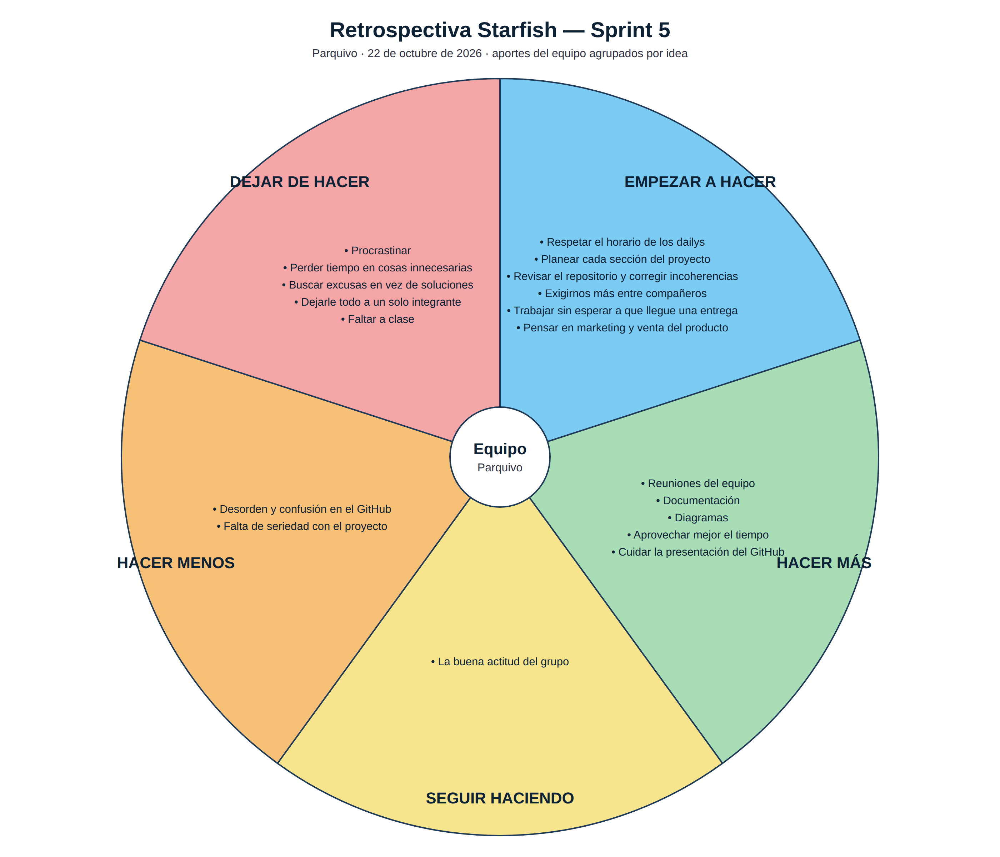

# Retrospectiva Starfish · Sprint 5

**Parquivo** · Fundamentos de Ingeniería de Software (12946) · 2026-2

El Starfish (estrella de mar) divide la retrospectiva en cinco partes:

| Parte | Pregunta |
|---|---|
| **Empezar a hacer** | ¿Qué deberíamos empezar a hacer? |
| **Dejar de hacer** | ¿Qué no aporta y deberíamos dejar? |
| **Seguir haciendo** | ¿Qué funciona bien y hay que mantener? |
| **Hacer más** | ¿Qué funciona y conviene hacer con más frecuencia? |
| **Hacer menos** | ¿Qué aporta poco y conviene reducir? |

---

## Sprint 5 · 22 de octubre de 2026

Cada integrante escribió sus aportes. Hubo 52, muchos repetidos porque varias
personas coincidieron en la misma idea; se agruparon en 19 ideas. La foto del
tablero de la sesión es [`StarfishRetro.jpeg`](StarfishRetro.jpeg).

| Parte | Idea | Veces que se propuso |
|---|---|:---:|
| Empezar a hacer | Respetar el horario de los dailys | 9 |
| Empezar a hacer | Planear cada sección del proyecto | 2 |
| Empezar a hacer | Revisar el repositorio y corregir incoherencias | 2 |
| Empezar a hacer | Exigirnos más entre compañeros | 2 |
| Empezar a hacer | Trabajar sin esperar a que llegue una entrega | 2 |
| Empezar a hacer | Pensar en marketing y venta del producto | 1 |
| Hacer más | Reuniones del equipo | 1 |
| Hacer más | Documentación | 1 |
| Hacer más | Diagramas | 1 |
| Hacer más | Aprovechar mejor el tiempo | 1 |
| Hacer más | Cuidar la presentación del GitHub | 11 |
| Seguir haciendo | La buena actitud del grupo | 2 |
| Hacer menos | Desorden y confusión en el GitHub | 4 |
| Hacer menos | Falta de seriedad con el proyecto | 1 |
| Dejar de hacer | Procrastinar | 4 |
| Dejar de hacer | Perder tiempo en cosas innecesarias | 2 |
| Dejar de hacer | Buscar excusas en vez de soluciones | 2 |
| Dejar de hacer | Dejarle todo a un solo integrante | 3 |
| Dejar de hacer | Faltar a clase | 1 |

## Plan de acción

Tomado de la [matriz de hallazgos](matriz-de-hallazgos.docx):

| Hallazgo | Acción | Responsable | Fecha | Se verifica con |
|---|---|---|---|---|
| Mejorar la estética del repositorio (ordenar) | Reorganizar la estructura del repositorio por carpetas y sacar los archivos sueltos | Sergio y Cristian | 30 de octubre | README actualizado y raíz limpia |
| Trabajar más sin necesidad de una próxima entrega | Cada integrante cierra al menos una tarjeta del tablero por semana, sin esperar la fecha de entrega | Todos | 30 de octubre y cada viernes | Historial de commits repartido en la semana, no concentrado el último día |
| Hacer menos confuso el GitHub | Acordar la convención de ramas y de mensajes de commit; cada tarjeta del tablero queda enlazada a su *issue* | Todos | 30 de octubre | Ramas con el nombre acordado y ninguna tarjeta en borrador sin *issue* |

## Lo que el equipo concluye

- **Lo que más se repitió** fue respetar el horario de los dailys y cuidar la
  presentación del GitHub: son los dos compromisos del Sprint 6.
- **La organización del repositorio** aparece en tres partes a la vez (empezar a
  revisarlo, cuidar su presentación y reducir la confusión), y es la primera
  acción del plan.
- **Los aportes de la retrospectiva no son trabajo del backlog**: se recogen en
  este documento y no como *issues* del tablero.
- **La buena actitud del grupo** es lo que se quiere conservar.
