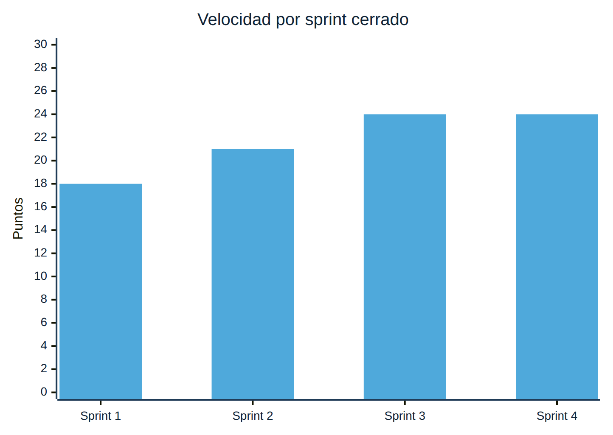
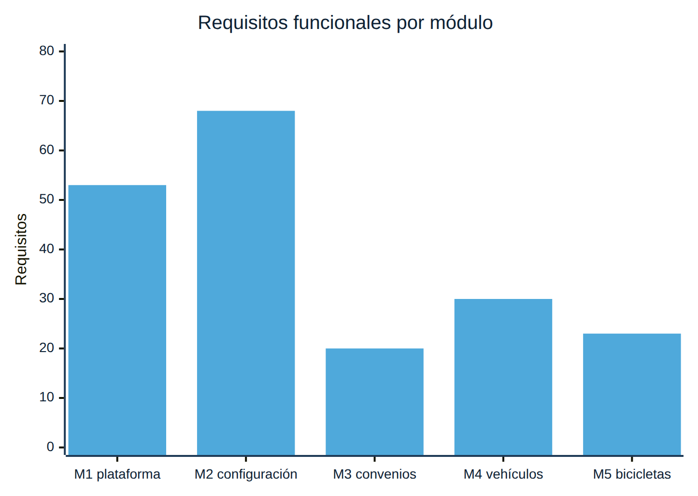

# Gráficas de avance

**Parquivo** · Fundamentos de Ingeniería de Software (12946) · 2026-2
**Corte:** 23 de octubre de 2026 · Sprint 5 en curso

---

## Puntos comprometidos y entregados por sprint

Los cuatro sprints cerrados entregaron todo lo comprometido: **87 de 87
puntos**. El Sprint 5 está en curso, con 13 de sus 26 puntos cerrados a la mitad
del periodo. El Sprint 6 todavía no empieza.

---

## Trabajo restante

De 122 puntos quedan **22**. Si el Sprint 5 cierra completo, al Sprint 6 le
quedan 9 puntos de pruebas y documentación de despliegue.

---

## Velocidad

Media de **21,75 puntos por sprint**. Se estabilizó en 24 desde que se estima
entre los cuatro integrantes.

---

## Reparto de la carga por persona

| Sprint | Cristian | Sergio | Jacob | Santiago | Total |
|---|:---:|:---:|:---:|:---:|:---:|
| Sprint 1 | 5 | 5 | 8 | — | **18** |
| Sprint 2 | 8 | 5 | 5 | 3 | **21** |
| Sprint 3 | 8 | 3 | 5 | 8 | **24** |
| Sprint 4 | 3 | 8 | 8 | 5 | **24** |
| Sprint 5 | 8 | 13 | — | 5 | **26** |
| Sprint 6 | — | — | 6 | 3 | **9** |
| **Total** | **32** | **34** | **32** | **24** | **122** |

Además de los puntos de historia, en el Sprint 5 cada integrante tiene a cargo
un diagrama del diseño de la solución.

---

## Distribución de los requisitos

194 requisitos funcionales y 14 no funcionales. El módulo de configuración es el
más grande porque concentra tarifas, horarios, turnos y cuentas: todo lo que un
establecimiento declara antes de poder cobrar.

---

Las cifras salen del tablero del proyecto, de los *milestones* de GitHub y de
[`Docs/SRS/SRS-simplificado.md`](../Docs/SRS/SRS-simplificado.md). Se rehacen en
cada cierre de sprint.
