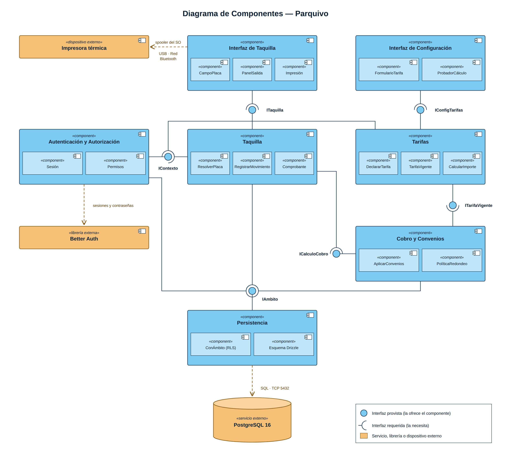

# Diagrama de Componentes

Fuente: [`03-componentes/generar.py`](03-componentes/generar.py) → [`diagrama-componentes.svg`](03-componentes/diagrama-componentes.svg)

## Qué modela

La arquitectura modular de Parquivo: siete componentes internos (en azul),
cada uno con sus subcomponentes, conectados por interfaces, y tres elementos
externos (en naranja).

### Componentes internos

| Componente | Subcomponentes | Código |
|---|---|---|
| **Interfaz de Taquilla** | CampoPlaca, PanelSalida, Impresión | `src/app/(establecimiento)/taquilla/` |
| **Interfaz de Configuración** | FormularioTarifa, ProbadorCálculo | `src/app/(establecimiento)/configuracion/tarifas/` |
| **Taquilla** | ResolverPlaca, RegistrarMovimiento, Comprobante | `src/dominio/taquilla/` |
| **Tarifas** | DeclararTarifa, TarifaVigente, CalcularImporte | `src/dominio/tarifas/` |
| **Cobro y Convenios** | AplicarConvenios, PolíticaRedondeo | `src/dominio/convenios/`, `src/dominio/cobro/` |
| **Autenticación y Autorización** | Sesión, Permisos | `src/lib/sesion.ts`, `src/lib/autorizacion.ts` |
| **Persistencia** | ConÁmbito (RLS), Esquema Drizzle | `src/db/` |

### Interfaces

El círculo marca la interfaz **provista** (la que el componente ofrece) y el
semicírculo la **requerida** (la que necesita de otro).

| Interfaz | La provee | La requiere | Contrato |
|---|---|---|---|
| `ITaquilla` | Taquilla | Interfaz de Taquilla | Resolver una placa, registrar entrada y salida |
| `IConfigTarifas` | Tarifas | Interfaz de Configuración | Declarar una tarifa y probar el cálculo |
| `ICalculoCobro` | Cobro y Convenios | Taquilla | Calcular el cobro con convenios y redondeo |
| `ITarifaVigente` | Tarifas | Cobro y Convenios | Entregar la tarifa vigente en una fecha |
| `IContexto` | Autenticación y Autorización | Taquilla, Tarifas | Quién es el usuario, su rol y su establecimiento |
| `IAmbito` | Persistencia | Taquilla, Cobro y Convenios, Autenticación | Abrir una transacción limitada al establecimiento |

### Elementos externos

| Elemento | Tipo | Relación |
|---|---|---|
| **PostgreSQL 16** | Servicio externo (base de datos) | Persistencia lo usa por SQL sobre TCP 5432 |
| **Better Auth** | Librería externa | Autenticación delega en ella las sesiones y las contraseñas |
| **Impresora térmica** | Dispositivo externo | La Interfaz de Taquilla imprime a través del spooler del sistema operativo (USB, red o Bluetooth) |

## Decisiones que muestra

- **Ningún componente toca la base directamente.** Todo acceso pasa por
  `IAmbito`, que fija el establecimiento antes de cualquier consulta; así la
  seguridad por filas (RLS) de PostgreSQL aísla los datos de cada parqueadero.
- **La taquilla no sabe calcular.** Pide el cobro por `ICalculoCobro`, y Cobro y
  Convenios a su vez pide la tarifa por `ITarifaVigente`. Un cambio en las
  reglas de cobro no obliga a tocar la taquilla.
- **La impresión no pasa por el servidor.** Una impresora del local tiene
  dirección privada y el servidor no la alcanza; por eso el trabajo sale desde
  el navegador de la caseta.
