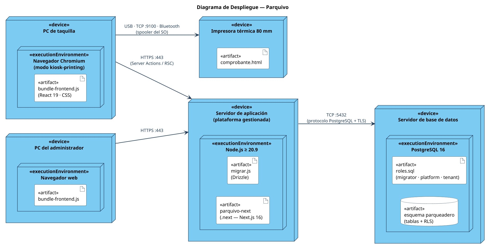

# Diagrama de Despliegue

Fuente: [`04-despliegue/diagrama-despliegue.puml`](04-despliegue/diagrama-despliegue.puml)

## Qué modela

La infraestructura donde corre Parquivo: cinco nodos físicos o virtuales, los
artefactos desplegados en cada uno y los protocolos con sus puertos.

### Nodos y artefactos

| Nodo «device» | Entorno de ejecución | Artefactos |
|---|---|---|
| **PC de taquilla** | Navegador Chromium en modo `--kiosk-printing` | `bundle-frontend.js` (React 19 y CSS) |
| **Impresora térmica 80 mm** | — | `comprobante.html` (el tiquete) |
| **PC del administrador** | Navegador web | `bundle-frontend.js` |
| **Servidor de aplicación** (plataforma gestionada) | Node.js ≥ 20.9 | `parquivo-next` (compilación `.next` de Next.js 16) y `migrar.js` (migraciones Drizzle) |
| **Servidor de base de datos** | PostgreSQL 16 | Esquema `parqueadero` con sus tablas y políticas RLS, y `roles.sql` con los tres roles |

### Comunicaciones

| Desde | Hacia | Protocolo | Puerto |
|---|---|---|---|
| PC de taquilla | Servidor de aplicación | HTTPS (Server Actions y React Server Components) | 443 |
| PC del administrador | Servidor de aplicación | HTTPS | 443 |
| Servidor de aplicación | Servidor de base de datos | Protocolo PostgreSQL sobre TCP con TLS | 5432 |
| PC de taquilla | Impresora térmica | Spooler del sistema operativo: USB, TCP (RAW) o Bluetooth | 9100 en red |

## Infraestructura necesaria

| Elemento | Requisito |
|---|---|
| PC de taquilla | Cualquier equipo capaz de ejecutar Chromium, con la impresora térmica configurada como predeterminada |
| Impresora | Térmica de 80 mm, conectada por USB, red o Bluetooth |
| Servidor de aplicación | Plataforma gestionada con Node.js 20.9 o superior y certificado TLS para el dominio |
| Base de datos | PostgreSQL 16 o superior con **permiso para crear roles** (`BYPASSRLS`); si hay agrupador de conexiones, en modo transacción |
| Variables de entorno | `DATABASE_URL_MIGRATOR`, `DATABASE_URL_PLATFORM`, `DATABASE_URL_TENANT`, `AUTH_SECRET`, `APP_URL` |

Los tres roles de la base no son opcionales: `app_migrator` es el dueño del
esquema, `app_platform` atraviesa RLS sólo para autenticación y administración
global, y `app_tenant` atiende todo lo demás sin poder saltarse el aislamiento.
